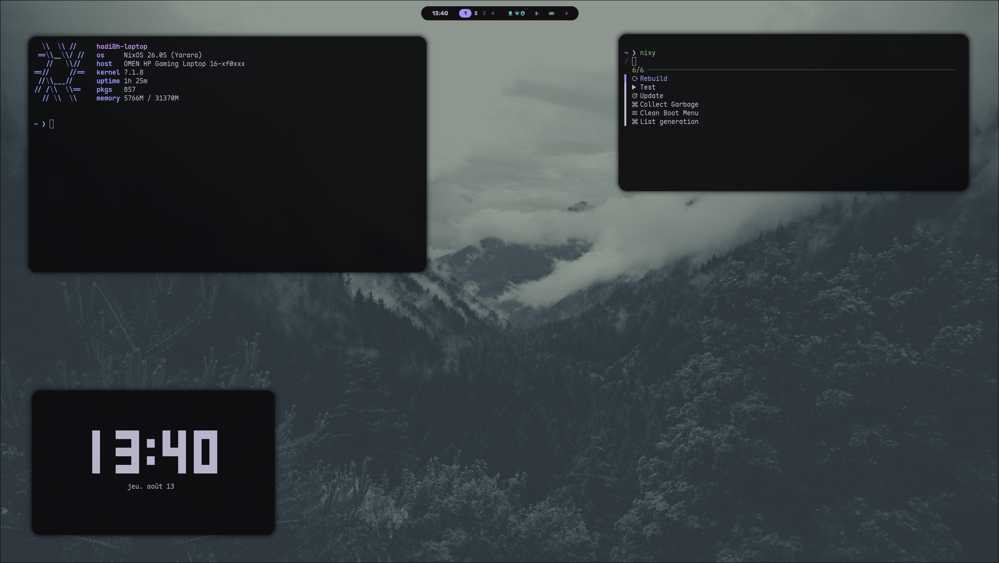
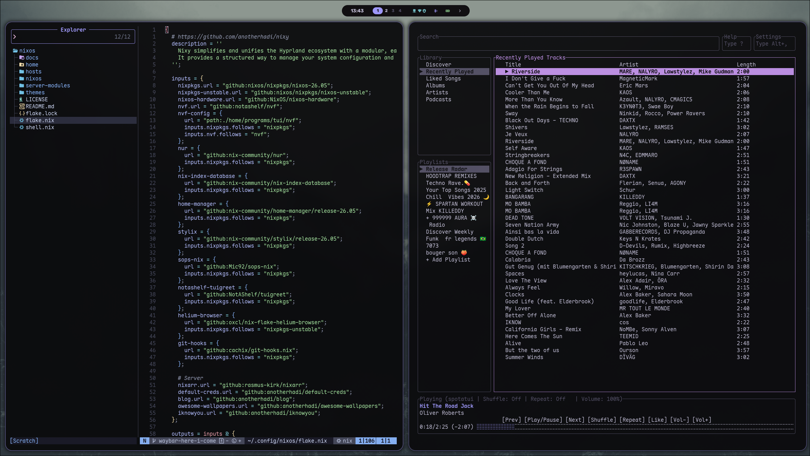
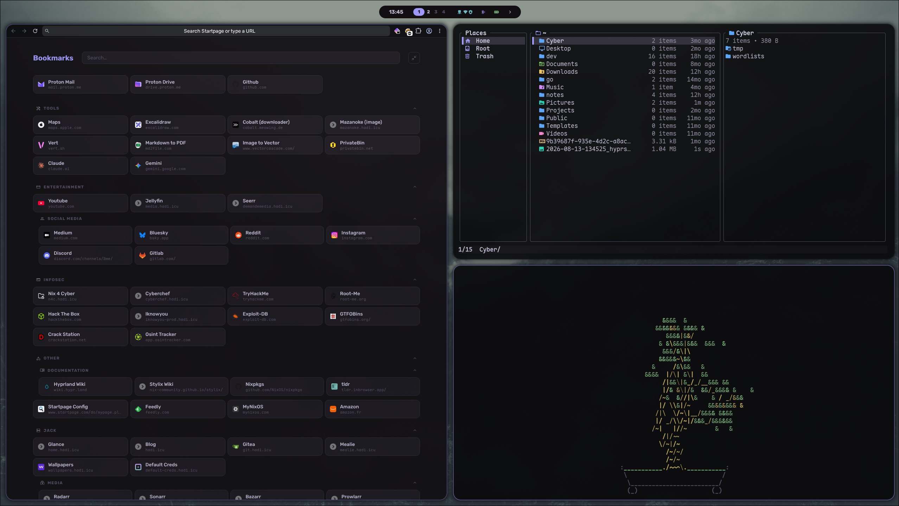

    

 

# Nixy

 

    
    
    
    

 

Nixy is a modular NixOS configuration. It is:

- [Hardened](#hardened)
- Minimalist
- [Stable](#why-stable)
- [Dendritic](#structure)
- Focused on TUIs: I f**king love them, so I have a lot of them ([why?](#why-tuis))
- Consistently themed
- A server config as well (I love to self-host things)

My main use is infosec-related. I do bug bounty, CTF and pentesting using this machine. This is also my main machine, so I do a lot of random stuff on it.

## Screenshots

## Hardened?

- [Impermanence](https://github.com/nix-community/impermanence): `/` is wiped on boot, only a few files & folders are stored on a persistent partition.
- [sops-nix](https://github.com/Mic92/sops-nix): secrets are stored in the repo, encrypted with an age key.
- Sandbox: most of my apps are sandboxed with minimal permissions, using [nixpak](https://github.com/nixpak/nixpak) (see [`modules/lib/sandbox.nix`](modules/lib/sandbox.nix)).
- [Kernel hardening](modules/system/kernel-hardening.nix) config.
- [LUKS](https://wiki.nixos.org/wiki/Full_Disk_Encryption): encrypted drive, partitioned declaratively with [disko](https://github.com/nix-community/disko).
- Secure boot: enabled on NixOS thanks to [lanzaboote](https://github.com/nix-community/lanzaboote).

## Structure

Nixy follows the [dendritic pattern](https://github.com/mightyiam/dendritic): every file under `modules/` is a [flake-parts](https://flake.parts) module, auto-imported by [import-tree](https://github.com/denful/import-tree), that defines one feature (an _aspect_) across every layer it touches: system, user (via [hjem](https://github.com/feel-co/hjem)), persistence, theming. Aspects are grouped into [bundles](modules/bundles.nix) (`base`, `tui`, `homelab`...), and hosts just pick the bundles and aspects they want.

## Installation / Usage

Nixy is my personal config: it's not meant to be installed as-is (hardware, disks, secrets and users are mine). Feel free to read it, steal modules, and adapt them. Most aspects are self-contained, so copying a single file from `modules/` is usually enough.

If you still want to try it:

1. Fork the repo and clone it to `~/.config/nixos` (or set `nixy.configDirectory` to wherever you put it)
2. Copy a host from [`modules/hosts/`](modules/hosts) and replace its hardware configuration, disko layout and secrets with yours (`sops` + your own age key)
3. Pick the bundles/aspects you want in the host's `default.nix`
4. Build with `nixy rebuild` (or `nh os switch .`)

## Why?

### Why Sway?

I was on [Hyprland](https://hypr.land) for a few years, but I wanted something more minimalist & more stable. [Sway](https://swaywm.org) does exactly that.

### Why stable?

Running unstable and getting the latest features as soon as they land was fun, but now I prefer a config that needs less maintenance. Nixy follows the latest NixOS release, and only a few packages here and there come from `nixpkgs-unstable`, when I need a specific feature or fix.

### Why TUIs?

They're keyboard-driven, fast to start, light on resources and usually local-first: no account, no Electron, no telemetry. They all live in the same terminal, with the same theme, the same keybindings and the same workflow. And they work the same way on my laptop and over SSH on my server.

### Why impermanence?

With `/` wiped on every boot, the only state on my machine is the state I explicitly declared. No forgotten config files, no leftovers from a program I tried once, no hidden drift between what the repo says and what the machine is. It's also a security win: anything that would persist outside of `/persist` (malware, tampered files) is gone after a reboot.

### Why the dendritic pattern?

One file = one feature. Everything related to a program (packages, config, persisted folders, sandbox, theme) lives in the same place, so adding a feature means adding a file, and removing it means deleting that file. No `imports` lists to maintain by hand: import-tree loads everything, and hosts just choose which aspects they enable.

---

  <a href="https://github.com/anotherhadi/nixy">github</a> |
  <a href="https://git.hadi.icu/anotherhadi/nixy">gitea (mirror)</a>

